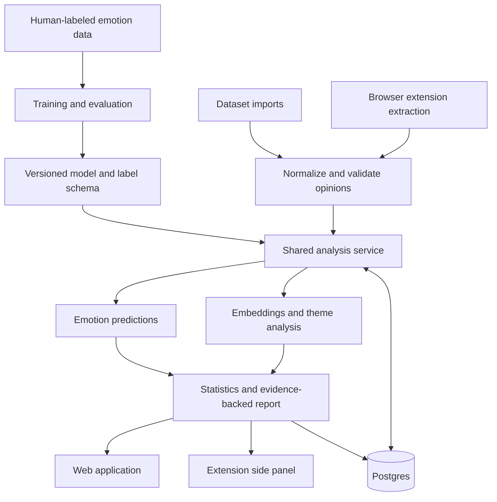

# Emotion-Aware Analytics System: Project Plan

**Updated:** November 3, 2026

**Status:** Product direction documented; pivot implementation has not started.

**Scope:** The trained emotion model, opinion analytics, reports, web application, future browser extension, and migration from the existing prototype.

**Execution plan:** [DEVELOPMENT_ROADMAP.md](DEVELOPMENT_ROADMAP.md) defines the checkpoints, validation gates, progress states, commits, and PR merges for this plan.

## Product goal

Build a system that analyzes many real opinions about a defined subject and explains the emotional patterns in them. Subjects can include products, everyday services and experiences, public issues, and discrete events.

The central workflow is:

1. Collect or import opinions associated with a subject.
2. Apply our trained emotion-recognition model to each opinion.
3. Identify recurring themes and their associations with predicted emotions.
4. Generate a report with statistics, comparisons, and supporting excerpts.
5. Present the findings through a web application or browser extension.

The model predicts emotions expressed in text. Its outputs are estimates, rather than direct measurements of someone's internal emotional state. Findings describe the collected material and its coverage.

### Direction and open choices

| Decision | Status |
| --- | --- |
| Cover both everyday experiences and event-related opinions | Agreed direction |
| Train an emotion model and generate analytical reports | Agreed direction |
| Add a browser extension after the core system works | Agreed direction |
| Use one analysis engine for imports and extension inputs | Recommended architecture |
| Start with English product reviews in one category | Recommended first scope; exact category remains open |
| Start with GoEmotions and fine-tune a pretrained encoder | Recommended experiment; assess data and compute before selecting the final model |
| Choose the first extension website and deployment provider | Open; select after feasibility checks |

## First useful version

Start with a small set of products from one category, with enough English reviews to compare themes and emotions. Select the cohort based on actual text quality, volume, metadata, and manageable download size.

For example, a headphone-review analysis could compare comfort, battery life, connectivity, and customer support. A hypothetical finding might be: "Disappointment is more frequent in opinions mentioning battery life than in those mentioning comfort." The report must include the actual counts and supporting excerpts before making that statement.

The first version will support dataset imports, batch inference, theme exploration, and a downloadable report. It will not depend on live Reddit access. Event analysis will use the same input contract with event/topic identifiers and suitable context.

The first demonstrable outcome is **one evaluated model plus one reproducible report over a real collection of opinions**. The extension follows after that outcome is reliable.

## Data strategy

### Training data and analysis data

These are separate resources:

- **Training data** contains human emotion annotations and teaches the classifier what its labels mean.
- **Analysis data** contains real opinions and subject metadata. It does not need existing emotion labels for inference, but a human-labeled sample is needed to evaluate performance in that domain.

| Resource | Intended use | Important distinction |
| --- | --- | --- |
| [GoEmotions](https://github.com/google-research/google-research/tree/master/goemotions) | Initial supervised training and benchmark evaluation | Approximately 58,000 annotated comments, with 27 emotion categories plus neutral and published splits. Although the comments originated on Reddit, the published dataset can be downloaded without live Reddit API access. |
| [Amazon Reviews'23](https://amazon-reviews-2023.github.io/) | First everyday-experience analysis corpus | Downloadable review text, product identifiers, metadata, and timestamps. Star ratings are not emotion annotations. Use a bounded subset. |
| [Regulations.gov](https://open.gsa.gov/api/regulationsgov/) | Later public-issue or proposal analysis | Comment text, document/docket grouping, and dates through an official API requiring key registration. Inspect topic coverage, duplicate campaigns, and attachments before selecting a collection. |
| User-provided CSV/JSON or a focused feedback collection | Additional domains and domain evaluation | Preserve collection context and distinguish original observations from generated examples. |

Begin with a repeatable file import. Source connectors are separate adapters, so the analysis pipeline can operate without continuous access to a particular platform.

For each dataset, record its publisher, version, source URL, usage conditions, attribution, fields, label definitions, and selection criteria. External data is not covered by this repository's MIT license.

### Import and preparation

- Preserve source identity, subject grouping, original text, available timestamps, and evidence references.
- Record raw, usable, duplicate-group, excluded, and successfully analyzed counts.
- Detect exact and near duplicates. Retain provenance and disclose how duplicate groups affect reported counts.
- Flag empty text, unsupported languages, and invalid records with explicit reasons.
- Keep text that carries emotion, including negation and punctuation; document preprocessing.
- Keep analysis data separate from benchmark training and test sets.
- Use time comparisons only when publication dates and collection windows support them. An import timestamp is not an opinion's publication date.

## Model training and evaluation

### Training approach

1. Define the initial label schema using the selected training dataset's native labels.
2. Establish a multi-label TF-IDF/logistic-regression baseline.
3. Fine-tune a pretrained text encoder, initially evaluating BERT or DistilBERT according to available compute.
4. Tune per-label decision thresholds on validation data.
5. Evaluate once on the held-out test set and separately on the application-domain sample.
6. Save the selected model, tokenizer, thresholds, label schema, preprocessing settings, training configuration, metrics, and dataset versions.

Fine-tuning gives the project its own trained classifier without pretraining a language model from scratch. One opinion may carry several labels. Neutral is a label; it must not be used as a substitute for uncertainty or failed inference.

The old eight Plutchik fields are not automatically compatible with GoEmotions. Any later grouping into broader emotions must have a documented mapping and evaluation. Probability/confidence scores are not measurements of emotional intensity. A model trained on categorical emotion labels will not automatically produce calibrated valence, arousal, or summaries.

### Evaluation requirements

- Use the published benchmark splits, audit overlap, and keep application data used for development separate from final domain evaluation.
- Prevent exact or near-duplicate leakage. For custom splits, group related examples where appropriate and fit preprocessing only on training data.
- Report micro-F1, macro-F1, and per-label precision, recall, F1, and sample counts.
- Create a manually labeled sample from the chosen application domain; a few hundred examples is an initial planning target, adjusted for label coverage.
- Write annotation guidance, review ambiguous examples, and double-annotate a subset to assess agreement.
- Inspect errors involving mixed emotions, negation, sarcasm, rare labels, and domain-specific language.
- Evaluate performance on held-out products/topics or later time periods when claiming that the model generalizes to them.
- Measure batch throughput, latency, and model size before choosing deployment and extension batch limits.

Set numerical acceptance targets after the baseline and data audit. Do not assume benchmark performance transfers to a new domain or promise an accuracy figure before evaluation.

## Analysis and reports

The analysis engine will combine predictions with themes, grouping metadata, and evidence. Emotion inference and report generation are separate responsibilities.

| Report section | Required content |
| --- | --- |
| Collection overview | Subject, sources, date range where known, selection criteria, and coverage |
| Processing summary | Raw, excluded, duplicate, successful, uncertain, and failed counts |
| Emotion distribution | Predicted-label counts and percentages with explicit denominators |
| Theme analysis | Recurring themes, theme sizes, emotion associations, and examples |
| Comparisons | Differences across products/topics or valid time windows |
| Supporting evidence | Excerpts with opinion IDs and source references |
| Interpretation limits | Sampling limitations, uncertainty, and unsupported comparisons |
| Reproducibility | Analysis ID, model and label-schema versions, thresholds, and input snapshot/version |

Because the task is multi-label, percentages across emotions may exceed 100%. State whether a percentage uses all successfully analyzed opinions or a defined subset. Report excluded and uncertain cases explicitly.

Initially, emotion/theme associations can describe co-occurrence within an opinion. A review discussing several aspects does not establish which aspect caused each emotion. More precise aspect claims require sentence/span-level evidence and validation.

Theme discovery needs its own evaluation. Existing embeddings and HDBSCAN are candidates, but grouping near-duplicate news posts does not establish that the same settings identify useful review themes. Review sample clusters, their names, and their supporting comments. Small extension batches may need simpler grouping or an explicit "insufficient evidence" result.

Generate the first report from computed statistics and templates, with HTML and JSON outputs as the initial targets. Any later language-model narration must use those statistics and evidence references. It must not invent counts, explanations, or quotations.

Observed before/after differences do not establish causation. Emotion also does not establish support or opposition to a policy; stance would require a separately defined and evaluated task.

## Target architecture

This diagram describes planned components, not the current implementation.

Keep training offline from serving. Begin analysis with local scripts and bounded API batches. Add background job execution for larger imports if measured runtimes require it; the previous requirement that everything finish within one HTTP request does not carry over.

FastAPI and Postgres remain suitable starting points. PyTorch/Hugging Face tooling is a candidate for training and inference; sentence-transformers remains a candidate for semantic embeddings. Web and extension interfaces can use TypeScript. Hosting, compute costs, and exact dependency versions will be selected during implementation rather than inheriting the old deployment assumptions.

### Shared data contracts

Design new contracts before adapting the old dataclasses:

| Record | Essential information |
| --- | --- |
| Collection | ID, subject/topic, source description, selection criteria, and coverage |
| Opinion | Stable ID, collection ID, subject ID, text, source identity, optional original ID/URL/publication time/language, capture time, and source metadata |
| Prediction | Opinion/content version, model version, label-schema version, label scores, selected labels, threshold configuration, and inference status |
| Analysis run | Input snapshot, scope/filter settings, processing counts, model/analysis versions, status, and timestamps |
| Report | Analysis ID, aggregate results, theme memberships, evidence references, and export metadata |

Product ratings, Reddit scores, and other source-specific fields belong in optional metadata. They must not be mandatory for every opinion. Missing publication dates remain missing.

Cache inference using source-scoped identity/content hashes, model version, label schema, and preprocessing version. Retain enough prediction and analysis history to reproduce reports instead of overwriting the only result. Keep updated source metadata separate from cached predictions.

### Proposed API boundary

These routes are design targets and do not exist yet:

- `POST /analyses`: accept a bounded opinion collection or an imported collection reference, with subject and coverage metadata.
- `GET /analyses/{analysis_id}`: return status, counts, results, and evidence references.
- `GET /analyses/{analysis_id}/report`: retrieve the generated report/export.

Both web uploads and browser extraction use the same service. Include explicit partial-failure and unsupported-input results, request limits, model-version metadata, and a clear distinction between pending and completed analysis.

## Browser extension

The extension is a later interface to the core analytics, using the same trained model and report calculations.

### First extension experience

1. The user opens a supported page with reviews or comments.
2. The user clicks **Analyze opinions**.
3. A site adapter extracts individual opinions and the available subject/source metadata.
4. The extension shows what will be analyzed and sends the extracted opinion text to the shared API.
5. A side panel displays coverage, emotion distributions, themes, and supporting comments.
6. The user can inspect evidence and open a fuller report.

For example, the panel might state "Analyzed 40 reviews loaded on this page" and show which themes co-occur with disappointment or appreciation. That is an illustrative interface, not a measured result.

### Extraction and coverage

Start with one website whose accessible comment markup can be extracted reliably. Inspect it before committing to support. Add adapters individually rather than assuming every page has the same structure.

- Extract opinion text separately from product descriptions, advertisements, navigation, and the article itself.
- Account for pagination, collapsed text, dynamically loaded comments, and repeated scans.
- Clearly distinguish comments loaded/extracted from the site's advertised total.
- Refresh the result when its captured page snapshot changes; do not merge scans in a way that double-counts comments.
- Display unsupported-page and insufficient-data states.
- Provide a selected-text or paste/import fallback where useful.

Use click-triggered access for the first version, with the required browser permissions. Make server processing clear and send only the extracted text and needed metadata. Automatic analysis on supported sites can be an optional later setting with explicit site access.

Server inference is the initial architecture. Local browser inference is a later experiment dependent on model size, runtime compatibility, and measured performance.

Chrome's official documentation covers [content scripts](https://developer.chrome.com/docs/extensions/develop/concepts/content-scripts), [temporary active-tab access](https://developer.chrome.com/docs/extensions/develop/concepts/activeTab), and [side panels](https://developer.chrome.com/docs/extensions/reference/api/sidePanel). A side panel supports reading findings alongside the page; a [toolbar popup](https://developer.chrome.com/docs/extensions/develop/ui/add-popup) closes when focus moves outside it.

## Existing code and migration

**Recommendation: keep this repository and selectively reuse infrastructure while building a clean analysis workflow.** Preserve the prototype during migration. New training, import, analysis, and report modules should start with the new product's contracts.

| Existing file or area | Action | Reason |
| --- | --- | --- |
| `api/src/main.py` | Reuse and adapt | FastAPI setup and health endpoint are useful. CORS currently allows only GET, while the new API will accept POST. |
| `api/src/embeddings.py` | Reuse and evaluate | Cached model loading and normalized batch embeddings are useful building blocks. |
| `api/src/ranking.py`: clustering | Extract/adapt after evaluation | HDBSCAN is a candidate for grouping themes; current storyline grouping is a different task. |
| `api/src/ranking.py`: priority scoring | Leave out of the new workflow | Upvotes, comment counts, post age, valence, and arousal are tied to the old ranking product. |
| `api/src/schema.py` | Redesign input contract | `ContentEvent` requires `subreddit`, score, and comment fields despite its source-neutral intent. |
| `api/src/emotion_schema.py`, `api/src/schemas.py` | Replace for new outputs | Fixed Plutchik fields, valence/arousal, summaries, and storyline outputs do not match a newly trained classifier's contract. |
| `api/src/db.py`, `db/migrations/` | Reuse patterns; add new schema | Parameterized access and migration tracking are useful. Existing rows mix Reddit metadata with one latest Claude classification. |
| `api/src/config.py`, dependency files | Adapt incrementally | Keep configuration conventions; separate training/serving needs and phase out legacy-only settings and dependencies. |
| `api/src/classify.py` | Replace primary inference | This calls Claude and contains no model training. Retain only as an optional comparison tool if needed. |
| `api/src/reddit_source.py`, `api/src/routes/landscape.py` | Preserve as legacy during migration | They implement the earlier source and endpoint; do not extend their contracts into the new product. |
| `scripts/seed_demo_data.py`, its fixtures | Replace the demo workflow | The current seed script calls Claude and writes legacy records to the configured database. |
| `tests/` | Retain useful checks; add new coverage | Embedding and persistence invariants are useful. Reddit ranking and Claude tests do not validate the new model or reports. |

Three migration details matter:

1. The trained classifier will not automatically replace everything Claude returned. Summaries and report prose need separate logic; valence/arousal need separate supervision if added later.
2. Current cache lookup matches external IDs without source scoping, and upserts overwrite predictions. Introduce versioned inference and reproducible analysis records.
3. Existing SQL migrations may already be applied. Add new migrations rather than rewriting those files or resetting a database.

No legacy code or data is deleted by this documentation update. Move legacy modules out of the active application path and remove obsolete dependencies only after the new workflow has meaningful validation. In particular, importing the new app should eventually work without Reddit or Claude credentials.

## Implementation milestones

The detailed execution and progress record is [DEVELOPMENT_ROADMAP.md](DEVELOPMENT_ROADMAP.md). Each checkpoint has its own deliverable, testing gate, demonstration, and commit boundary.

| Phase | Checkpoint IDs | Phase completion evidence |
| --- | --- | --- |
| 0. Project foundation | P0.C1, P0.C2, P0.C3 | Plan documented; new application isolated; credential-free checks run locally and in CI |
| 1. Data and contracts | P1.C1, P1.C2, P1.C3 | A real collection imports with traceable IDs and quality counts; domain evaluation data and protocol are ready |
| 2. Training | P2.C1, P2.C2, P2.C3 | Reproducible baseline and fine-tuning, held-out metrics, model selection, and versioned artifacts |
| 3. Core analytics | P3.C1, P3.C2, P3.C3 | One complete reproducible report with correct denominators, evidence, and explicit failure/exclusion handling |
| 4. API and web application | P4.C1, P4.C2, P4.C3 | A real imported collection can be analyzed, explored, and exported through the application |
| 5. Extension | P5.C1, P5.C2, P5.C3, P5.C4 | Verified extraction on one supported site and agreement with analysis of the same captured inputs |
| 6. Broader topics | P6.C1, P6.C2, P6.C3 | Separate domain evaluation, an event/issue report, and combined release validation |

Commit each completed checkpoint after its relevant checks pass. Use a PR for every merge to `main`; default to checkpoint-sized PRs and group checkpoints only when the roadmap's conditions are met. Phase completion requires merged checkpoints and a passing demonstration of the combined capability. These workflow rules are documented policy; GitHub CI and branch settings still need implementation in Phase 0.

Keep local experimentation possible before cloud deployment. Add operational controls and larger-job execution as the service is exposed and workloads are measured. Avoid treating an always-on collector or any particular hosting provider as a prerequisite.

## Next implementation step

After the documentation checkpoint, establish the isolated application and automated checks in P0.C2/P0.C3. Then audit a small real review sample and the chosen emotion training dataset, define the opinion/prediction contracts, and set up evaluation in Phase 1. This resolves the data and label assumptions before building the dashboard or extension.
